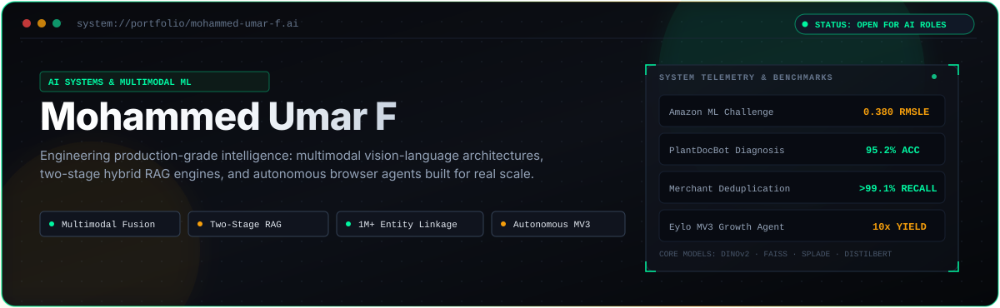

<div align="center">

<!-- Hero Terminal HUD (Dark Obsidian, Emerald Mint & Amber - Seamless with GitHub Dark) -->
<picture>
  <source media="(prefers-color-scheme: dark)" srcset="https://raw.githubusercontent.com/mdumr4/mdumr4/main/assets/header-banner.svg">
  
</picture>

<br/>

<!-- Fast Affordances -->
<p align="center">
  <a href="mailto:mdumr4@gmail.com">
    
  </a>
  &nbsp;
  <a href="https://linkedin.com/in/mdumr4">
    
  </a>
  &nbsp;
  <a href="https://x.com/mdumr4_">
    
  </a>
  &nbsp;
  
</p>

</div>

---

### ⚡ Executive Summary

> I build production-grade AI systems at the intersection of **vision-language foundation models**, **two-stage hybrid RAG engines**, and **autonomous browser agents**. My focus is bridging deep learning models with scalable data pipelines to deliver low-latency inference, zero hallucinated attribution, and verified competitive benchmarks.

---

### 🎛️ Flagship Systems Showcase

<table>
  <tr>
    <td width="50%" valign="top">
      <h3>📄 <a href="https://github.com/mdumr4/resume-ranker">resume-ranker</a></h3>
      <p><b>Enterprise Two-Stage Hybrid RAG Engine</b></p>
      <p>Two-stage candidate retrieval fusing dense <code>FAISS (HNSW)</code> vector search with sparse <code>SPLADE-v3</code> token expansions, pairwise <code>Cross-Encoder</code> reranking, and <code>Qwen 2.5</code> synthesis.</p>
      <p><b>Key Win:</b> <code>100% Explainable Rankings</code> with zero hallucinated attribution.</p>
      <p><sub><code>Python</code> · <code>FAISS</code> · <code>SPLADE-v3</code> · <code>Cross-Encoders</code> · <code>FastAPI</code></sub></p>
    </td>
    <td width="50%" valign="top">
      <h3>🏷️ <a href="https://github.com/mdumr4/Smart-Product-Pricing">Smart-Product-Pricing</a></h3>
      <p><b>Multimodal Pricing Engine · Amazon ML Challenge</b></p>
      <p>Dual-tower neural network fusing <code>DistilBERT</code> text tokens with <code>DINOv2 (ViT)</code> visual representations via cross-attention, streamed through Snappy Parquet into <code>LightGBM</code>.</p>
      <p><b>Key Win:</b> <code>0.380 RMSLE</code> benchmark, top competitive tier.</p>
      <p><sub><code>PyTorch</code> · <code>DINOv2</code> · <code>DistilBERT</code> · <code>LightGBM</code> · <code>Parquet</code></sub></p>
    </td>
  </tr>
  <tr>
    <td width="50%" valign="top">
      <h3>🌿 <a href="https://github.com/mdumr4/PlantDocBot">PlantDocBot</a></h3>
      <p><b>Multimodal Agronomy Diagnosis · Infosys Springboard</b></p>
      <p>Dual-tower agronomy diagnosis platform pairing deep convolutional foliage classification (<code>ResNet34</code>) with fine-tuned <code>DistilBERT</code> symptom extraction and dynamic confidence arbitration.</p>
      <p><b>Key Win:</b> <code>95.2% Diagnostic Accuracy</code> on complex multi-crop benchmarks.</p>
      <p><sub><code>PyTorch</code> · <code>ResNet34</code> · <code>DistilBERT</code> · <code>OpenCV</code> · <code>Streamlit</code></sub></p>
    </td>
    <td width="50%" valign="top">
      <h3>🤖 <a href="https://github.com/mdumr4/Eylo-Reddit-v2">Eylo-Reddit-v2</a></h3>
      <p><b>Autonomous Growth &amp; Outreach Agent</b></p>
      <p>Manifest V3 Chrome extension with anti-fingerprint DOM humanizers, randomized jitter dispatch, <code>GPT-4o-mini</code> intent qualification, and Supabase multi-account deduplication.</p>
      <p><b>Key Win:</b> <code>10x Qualified Discovery</code> with zero bot-detection flags.</p>
      <p><sub><code>Chrome MV3</code> · <code>TypeScript</code> · <code>GPT-4o-mini</code> · <code>Supabase</code></sub></p>
    </td>
  </tr>
  <tr>
    <td colspan="2" valign="top">
      <h3>🏢 <a href="https://github.com/mdumr4/Business-Entity-Resolution">Business-Entity-Resolution</a></h3>
      <p><b>Million-Scale Merchant Deduplication · Big Data &amp; Record Linkage</b></p>
      <p>Scalable record linkage pipeline combining <code>TF-IDF n-gram inverted index blocking</code> (pruning 99.8% of comparison pairs), vectorized Levenshtein edit distance matrices, and a gradient-boosted classification reranker.</p>
      <p><b>Key Win:</b> <code>&gt; 99.1% Candidate Pair Recall</code> across 1,000,000+ merchant records in sub-linear processing time.</p>
      <p><sub><code>Python</code> · <code>Scikit-Learn</code> · <code>Inverted Indexing</code> · <code>Levenshtein</code> · <code>Snappy Parquet</code></sub></p>
    </td>
  </tr>
</table>

---

### 🛠️ Technical Arsenal

| Domain | Production Tooling, Models & Frameworks |
| :--- | :--- |
| **Languages & Runtimes** | `Python 3.11+` (AsyncIO, PyTorch, NumPy) · `TypeScript` · `JavaScript (ES6+)` · `SQL (PostgreSQL / pgvector)` · `Bash` |
| **Deep Learning & Vision** | `PyTorch` · `DINOv2 (Meta ViT)` · `ResNet34` · `Hugging Face Transformers` · `Torchvision` · `OpenCV` · `LightGBM` |
| **Search, RAG & LLMs** | `FAISS (HNSW Indexing)` · `SPLADE-v3` · `Pairwise Cross-Encoders` · `Sentence-Transformers` · `Qwen 2.5` · `GPT-4o` |
| **Systems & Deployment** | `Chrome Extensions (MV3 APIs)` · `FastAPI` · `Supabase` · `Snappy Parquet` · `Docker` · `Streamlit` · `GitHub Actions` |

---

### 📊 GitHub Activity

<div align="center">
  <table border="0" cellspacing="0" cellpadding="0">
    <tr>
      <td align="center" valign="middle">
        <a href="https://github.com/mdumr4">
          
        </a>
      </td>
      <td align="center" valign="middle">
        <a href="https://github.com/mdumr4">
          
        </a>
      </td>
    </tr>
  </table>
</div>

---

### 📬 Connect

```bash
$ curl -s https://api.umar.dev/contact | jq .
{
  "name": "Mohammed Umar F",
  "role": "AI Systems Architect & Multimodal ML Engineer",
  "email": "mdumr4@gmail.com",
  "linkedin": "in/mdumr4",
  "twitter": "@mdumr4_",
  "location": "Bangalore, India",
  "status": "Open for Senior / Staff AI Roles"
}
```

<div align="center">
  <p align="center">
    <a href="mailto:mdumr4@gmail.com"><b>📧 Start a Conversation</b></a> &nbsp;•&nbsp;
    <a href="https://linkedin.com/in/mdumr4"><b>💼 Connect on LinkedIn</b></a> &nbsp;•&nbsp;
    <a href="https://x.com/mdumr4_"><b>𝕏 Follow on Twitter</b></a>
  </p>
</div>
