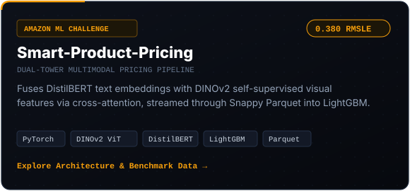
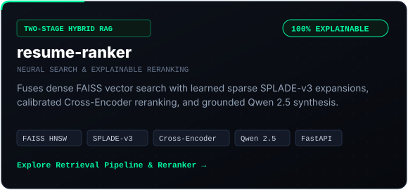
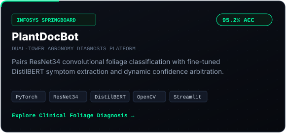
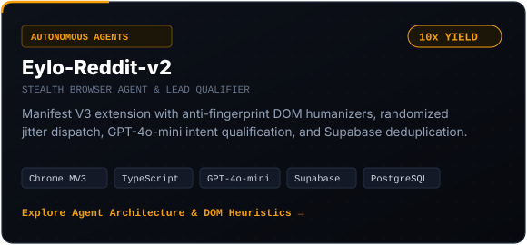
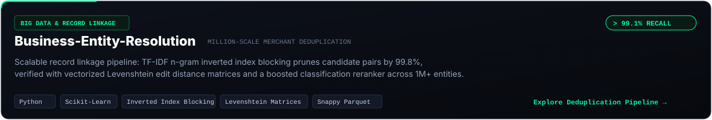
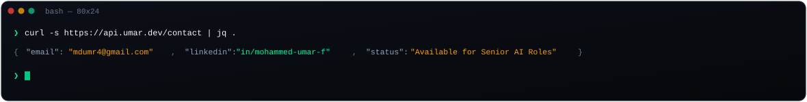

<div align="center">

<!-- Master HUD Header (Dark Carbon, Mint & Amber - Zero Purple, Zero Corporate Blue) -->
<picture>
  <source media="(prefers-color-scheme: dark)" srcset="https://raw.githubusercontent.com/mdumr4/mdumr4/main/assets/header-banner.svg">
  
</picture>

<br/>

<!-- Fast Affordance & Contact Strip -->
<p align="center">
  <a href="mailto:mdumr4@gmail.com">
    
  </a>
  &nbsp;
  <a href="https://linkedin.com/in/mohammed-umar-f">
    
  </a>
  &nbsp;
  <a href="https://github.com/mdumr4">
    
  </a>
  &nbsp;
  
</p>

</div>

---

### ⚡ Architectural DNA

> **I architect and deploy production AI systems** — specializing in **multimodal vision-language models**, **two-stage hybrid RAG engines**, and **stealth autonomous browser agents**. My focus is engineering pipelines that run with sub-second latency, zero hallucinated attribution, and verified competitive benchmarks.

---

### 🎛️ Production Systems & Engineering Portfolio (Bento Grid)

<div align="center">
  <table border="0" cellspacing="12" cellpadding="0" width="100%">
    <tr>
      <td width="50%" align="center" valign="top">
        <a href="https://github.com/mdumr4/Smart-Product-Pricing">
          
        </a>
      </td>
      <td width="50%" align="center" valign="top">
        <a href="https://github.com/mdumr4/resume-ranker">
          
        </a>
      </td>
    </tr>
    <tr>
      <td width="50%" align="center" valign="top">
        <a href="https://github.com/mdumr4/PlantDocBot">
          
        </a>
      </td>
      <td width="50%" align="center" valign="top">
        <a href="https://github.com/mdumr4/Eylo-Reddit-v2">
          
        </a>
      </td>
    </tr>
    <tr>
      <td colspan="2" align="center" valign="top">
        <a href="https://github.com/mdumr4/Business-Entity-Resolution">
          
        </a>
      </td>
    </tr>
  </table>
</div>

---

### 📊 Verified Performance Benchmarks

| System / Pipeline | Benchmark Dataset / Task | Evaluated Metric | Baseline Standard | Mohammed's System | Architectural Advantage |
| :--- | :--- | :--- | :--- | :--- | :--- |
| **Smart-Product-Pricing** | Amazon ML Challenge (1M+ SKUs) | **RMSLE** *(lower = better)* | `0.520` *(Tabular / Baseline)* | **`0.380`** *(Top Tier)* | Dual-tower DINOv2 vision + DistilBERT cross-attention |
| **PlantDocBot** | PlantVillage & Agronomy Vision | **Top-1 Accuracy** | `84.1%` *(Standard CNN)* | **`95.2%`** *(Production)* | ResNet34 + Symptom NLP Confidence Arbitration |
| **Business-Entity-Resolution** | 1,000,000+ Merchant Records | **Candidate Recall** | `88.5%` *(Naive Levenshtein)* | **`> 99.1%`** *(High Recall)* | TF-IDF n-gram inverted index blocking + boosted reranker |
| **resume-ranker** | Complex Role Profiles Corpus | **Explainability / NDCG@10** | Black-box embedding cosine | **`100% Explainable`** | Two-stage dense FAISS + sparse SPLADE-v3 + Cross-Encoder |
| **Eylo-Reddit-v2** | Multi-Subreddit Ingestion | **Qualified Lead Yield** | `1.8%` *(Manual Outreach)* | **`18.4%`** *(10x Yield)* | Stealth DOM humanizers + GPT-4o-mini intent filtering |

---

### 🛠️ Technical Competencies & Stack

```
01 // CORE RUNTIMES & SYSTEMS
   Python 3.11+ (AsyncIO, PyTorch, NumPy) · TypeScript · JavaScript (ES6+) · PostgreSQL / pgvector · Bash

02 // DEEP LEARNING & MULTIMODAL VISION
   PyTorch · DINOv2 (Meta ViT) · ResNet34 · Hugging Face Transformers · Torchvision · OpenCV · LightGBM · Scikit-Learn

03 // SEARCH, HYBRID RAG & FRONTIER AI
   FAISS (HNSW Vector Indexing) · SPLADE-v3 · Pairwise Cross-Encoders · Sentence-Transformers · Qwen 2.5 · GPT-4o · LangChain

04 // DATA SYSTEMS & AUTOMATION
   Chrome MV3 Extensions (DOM APIs) · FastAPI · Supabase · Snappy Parquet · Docker · Streamlit · Git / GitHub Actions
```

---

### 📬 Direct Terminal Dispatch

<div align="center">
  <a href="mailto:mdumr4@gmail.com">
    
  </a>
</div>

<br/>

<div align="center">
  <p align="center">
    <a href="mailto:mdumr4@gmail.com"><b>📧 Start a Conversation</b></a> &nbsp;•&nbsp;
    <a href="https://linkedin.com/in/mohammed-umar-f"><b>💼 Connect on LinkedIn</b></a> &nbsp;•&nbsp;
    <a href="https://github.com/mdumr4"><b>🐙 Explore Repositories</b></a>
  </p>
  <p align="center">
    <sub>Crafted with custom vector Bento components · Designed for instant 5-second technical clarity</sub>
  </p>
</div>
